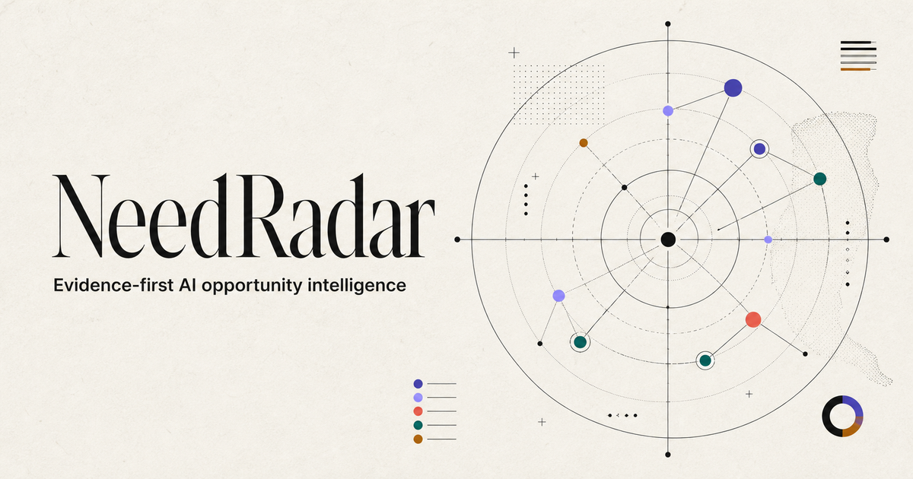
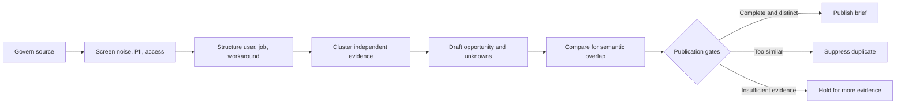

# NeedRadar



NeedRadar is an evidence-first decision system for finding AI-solvable workflow opportunities in public discussions without confusing public interest with validated demand.

**Live product:** [needradar-ai.xusihan615.chatgpt.site](https://needradar-ai.xusihan615.chatgpt.site)  
**AI strategy case deck:** [NeedRadar_AI_Strategy_Case_Study.pptx](portfolio/NeedRadar_AI_Strategy_Case_Study.pptx)

The live product opens in English and includes a persistent Chinese-language switch. This repository and every attached portfolio asset are English-only.

## Executive answer

The problem is not a shortage of AI ideas. It is the absence of a repeatable way to decide which workflow deserves evidence, a pilot, and organizational attention.

NeedRadar makes three things explicit:

1. **Provenance:** what was said, where, when, and under which source policy.
2. **Distinct demand:** whether a task is genuinely new or repeats an existing opportunity.
3. **Proof boundary:** what is a public signal and what still requires observed behavior.

The strategic recommendation is simple: **automate evidence preparation while keeping source rights, investment priority, and adoption decisions accountable to people.**

## Production snapshot

Snapshot retrieved from the public production API on **26 August 2026**.

| System output | Count | What it means |
|---|---:|---|
| Stored observations | 421 | Records retained by the governed evidence pipeline |
| Public observations | 117 | Reviewable source records exposed through the public layer |
| Published opportunity briefs | 10 | Deduplicated decision objects that passed publication gates |
| Source policies | 20 | 12 active and 5 submission-only at snapshot time |

These are production-system counts, **not market-validation metrics**. No customer count, adoption, revenue, savings, ROI, or product-market fit is claimed.

The current snapshot is preserved in [data/production-snapshot.json](data/production-snapshot.json).

## From signal to decision object



The public card is a decision object, not a scraped-post summary. It separates:

- the user and job to be done;
- the current workaround and desired outcome;
- the plausible AI mechanism;
- human decision gates;
- counterevidence and unknowns;
- source provenance and validation level.

## AI strategy and transformation contribution

| Consulting capability | NeedRadar evidence |
|---|---|
| Opportunity framing | Converts vague discussion into bounded workflow decisions |
| Operating-model design | Separates system preparation from accountable human judgment |
| AI governance | Encodes source policy, PII, access, evidence, and similarity gates |
| Product strategy | Defines validation levels from public signal to sustained outcome |
| Implementation | Runs a production evidence pipeline and a public bilingual product |
| Executive communication | States the recommendation, evidence, risks, and unproven claims separately |

My role covered product framing, evidence architecture, governance design, operating-model definition, implementation, quality controls, and portfolio communication.

## Representative policy code

This public repository is a **curated portfolio edition**, not a deployment mirror. It intentionally excludes production secrets, operational databases, personal data, and private administrative surfaces. It includes representative, runnable policy logic:

- [src/evidence-policy.mjs](src/evidence-policy.mjs) — evidence completeness and source-safety gates;
- [src/similarity.mjs](src/similarity.mjs) — transparent semantic-overlap scoring;
- [src/pipeline.mjs](src/pipeline.mjs) — publication, suppression, and hold decisions;
- [tests/pipeline.test.mjs](tests/pipeline.test.mjs) — executable policy examples.

Run the checks with Node.js 20 or newer:

```bash
npm test
npm run check:english
```

## Decision rights

**System / AI prepares:** normalization, noise and PII flags, classification, clustering, draft structure, similarity comparison, and reason logs.

**Accountable people decide:** source-rights exceptions, strategic priority, acceptable failure, real-task interpretation, and scale, redesign, or stop decisions.

The boundary follows decision risk. It is not a generic “human in the loop” label.

## What is proven and what is not

**Demonstrated:** a working evidence pipeline, traceable public observations, deduplicated opportunity briefs, source-policy controls, bilingual product delivery, automated tests, and explicit claim boundaries.

**Not yet demonstrated:** customer adoption, measured workflow improvement, commercial value, ROI, willingness to pay, or product-market fit.

See [docs/PORTFOLIO_CLAIMS.md](docs/PORTFOLIO_CLAIMS.md) for interview-safe wording and [docs/ROADMAP.md](docs/ROADMAP.md) for the proposed 90-day validation path.

## Repository map

| Path | Purpose |
|---|---|
| [docs/AI_STRATEGY_CASE_STUDY.md](docs/AI_STRATEGY_CASE_STUDY.md) | Full case narrative and recommendation |
| [docs/ARCHITECTURE.md](docs/ARCHITECTURE.md) | System layers and information flow |
| [docs/EVIDENCE_MODEL.md](docs/EVIDENCE_MODEL.md) | Evidence levels and interpretation rules |
| [docs/GOVERNANCE.md](docs/GOVERNANCE.md) | Decision rights, risks, and controls |
| [docs/ROADMAP.md](docs/ROADMAP.md) | Proposed 90-day discovery and pilot plan |
| [portfolio](portfolio) | Recruiter-ready presentation artifact |
| [src](src) | Representative policy implementation |
| [tests](tests) | Executable policy checks |

## Interview summary

> I built NeedRadar to solve a decision-quality problem, not an idea-generation problem. The system turns governed public signals into traceable AI opportunity briefs, automatically suppresses likely duplicates, and makes the validation boundary explicit. The implementation is working in production; customer adoption and business value remain hypotheses for a bounded pilot.

## License and data boundary

The representative code and original documentation in this repository use the MIT License. Third-party observations remain governed by their original source terms and are not relicensed here. This repository contains no operational dataset or personal data.

