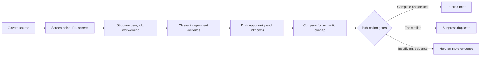

# NeedRadar


NeedRadar is an evidence-first decision system for finding AI-solvable workflow opportunities in public discussions without confusing public interest with validated demand.

**Live product:** [needradar-ai.xusihan615.chatgpt.site](https://needradar-ai.xusihan615.chatgpt.site)  
**AI strategy case deck:** [NeedRadar_AI_Strategy_Case_Study.pptx](portfolio/NeedRadar_AI_Strategy_Case_Study.pptx)

The live product opens in English and includes a persistent Chinese-language switch. This repository and every attached portfolio asset are English-only.

**29 October 2026 code milestones:** the public edition has immutable retrieval
snapshots, conservative review clusters, reversible split records and separate
evidence/validation state. Optional local multilingual embeddings now recover the
paired targets in the 140-case synthetic retrieval test, including the two prior
stress-query misses at 100/1,000/10,000 records. This improves candidate retrieval;
the offline pair policy still leaves 80 cases for semantic adjudication. The
earlier actual 12-pair Hermes pilot remains a separate, limited observation.
Default checks need only Node; local embeddings require explicit setup and have
measured CPU, startup and memory costs. No hosted deployment or market result is claimed.
See [local retrieval, measurements and setup](docs/local-retrieval-2026-10-29.md)
and [evidence clusters and reversible decisions](docs/evidence-clusters-2026-10-29.md).
The [earlier 16-pair comparison](docs/dedup-upgrade-2026-10-27.md) remains historical evidence.

Optional [review checkpoints](docs/review-continuation-2026-10-29.md) now let an
eight-call budget advance through later candidates across restarts. Content and
reviewer revision bind saved proposals; human corrections remain authoritative.
The fixed offline replay visits 20 distinct pairs in three invocations instead of
repeating the first eight. This improves scheduling, not measured model accuracy.

**30 October targeted follow-up:** fourteen real Hermes requests directly reviewed
the seven previously over-budget translated targets and seven nearby-distinct
controls. All matched the frozen synthetic labels; a separate zero-call replay
reused all fourteen grounded proposals. This is a selected-pair observation, not
completion of every retrieval queue, an independent accuracy estimate or measured
human time saved. [Protocol, results and offline replay](docs/targeted-semantic-followup-2026-10-30.md)
preserve unknown costs and the unchanged historical population results.

**Independent evidence correction:** attribution enrichment and repeat posts by
one author no longer create fresh independent demand. Known shared organizations
also constrain the author-count gate. Original captures and validation history
remain intact; legacy recency stays unverified until a new tracked arrival can
establish it. See [behavior, tests and migration boundaries](docs/evidence-origin-units-2026-10-30.md).

**31 October review consistency:** edits to a draft, evidence rights, human
corrections or comparison inputs during an asynchronous review now stop subsequent
requests and require a new review. Original responses stay bound to their original
content. [Behavior, integration, tests and snapshot costs](docs/review-input-consistency-2026-10-31.md)
also distinguish historical zero-call replay from the closed live experiment.
This fixes consistency; the 80 unresolved offline pairs remain unresolved.

## Executive answer

The problem is not a shortage of AI ideas. It is the absence of a repeatable way to decide which workflow deserves evidence, a pilot, and organizational attention.

NeedRadar makes three things explicit:

1. **Provenance:** what was said, where, when, and under which source policy.
2. **Distinct demand:** whether a task is genuinely new or repeats an existing opportunity.
3. **Proof boundary:** what is a public signal and what still requires observed behavior.

The strategic recommendation is simple: **automate evidence preparation while keeping source rights, investment priority, and adoption decisions accountable to people.**

## Production snapshot

Snapshot retrieved from the public production API on **26 August 2026**.

| System output | Count | What it means |
|---|---:|---|
| Stored observations | 421 | Records retained by the governed evidence pipeline |
| Public observations | 117 | Reviewable source records exposed through the public layer |
| Published opportunity briefs | 10 | Deduplicated decision objects that passed publication gates |
| Source policies | 20 | 12 active and 5 submission-only at snapshot time |

These are production-system counts, **not market-validation metrics**. No customer count, adoption, revenue, savings, ROI, or product-market fit is claimed.

That dated snapshot is preserved in [data/production-snapshot.json](data/production-snapshot.json);
it is not a current deployment or usage audit.

## From signal to decision object



The public card is a decision object, not a scraped-post summary. It separates:

- the user and job to be done;
- the current workaround and desired outcome;
- the plausible AI mechanism;
- human decision gates;
- counterevidence and unknowns;
- source provenance and validation level.

## AI strategy and transformation contribution

| Consulting capability | NeedRadar evidence |
|---|---|
| Opportunity framing | Converts vague discussion into bounded workflow decisions |
| Operating-model design | Separates system preparation from accountable human judgment |
| AI governance | Encodes source policy, PII, access, evidence, and similarity gates |
| Product strategy | Defines validation levels from public signal to sustained outcome |
| Implementation | Runs a production evidence pipeline and a public bilingual product |
| Executive communication | States the recommendation, evidence, risks, and unproven claims separately |

My role covered product framing, evidence architecture, governance design, operating-model definition, implementation, quality controls, and portfolio communication.

## Evidence-to-execution ecosystem

NeedRadar now acts as the portfolio's opportunity-intelligence front door without becoming a shared runtime dependency:

1. NeedRadar exports a governed `OPPORTUNITY_HANDOFF_V1` decision object.
2. [AI Skill Product Discovery](https://github.com/ValerianXXX/ai-skill-product-discovery) can evaluate the general-AI substitute, critical-data gap, authoritative sources, narrow scope, and human gates.
3. [BillFit](https://github.com/ValerianXXX/billfit) remains a bounded reference implementation; it is not attached to a current NeedRadar card without a semantic-fit review.
4. [From Feed to Agent](https://github.com/ValerianXXX/from-feed-to-agent) contributes evidence-handoff and provenance patterns as one research artifact.
5. [JobFlow](https://github.com/ValerianXXX/JobFlow) applies evidence, approval, privacy, and external-action controls without sharing private workflow data.

The public registry is in [data/project-registry.json](data/project-registry.json), and the contracts are in [schemas](schemas). See [docs/ECOSYSTEM.md](docs/ECOSYSTEM.md) for relationship semantics and the non-circular evidence policy.

## Representative policy code

This public repository is a **curated portfolio edition**, not a deployment mirror. It intentionally excludes production secrets, operational databases, personal data, and private administrative surfaces. It includes representative, runnable policy logic:

- [src/evidence-policy.mjs](src/evidence-policy.mjs) — evidence completeness and source-safety gates;
- [src/similarity.mjs](src/similarity.mjs) — Unicode lexical retrieval and conservative identity checks;
- [src/semantic-retrieval.mjs](src/semantic-retrieval.mjs) — optional local dense/lexical candidates with diversity and source-bound vectors;
- [src/semantic-review.mjs](src/semantic-review.mjs) — bounded grounded review and human corrections;
- [src/provenance.mjs](src/provenance.mjs) — capture grouping and provenance diagnostics;
- [src/evidence-independence.mjs](src/evidence-independence.mjs) — independent attribution units and arrival accounting;
- [src/opportunity-state.mjs](src/opportunity-state.mjs) — evidence and validation history;
- [src/opportunity-clusters.mjs](src/opportunity-clusters.mjs) — conservative human-reviewed groups and non-destructive splits;
- [src/pipeline.mjs](src/pipeline.mjs) — publication, suppression, and hold decisions;
- [tests/pipeline.test.mjs](tests/pipeline.test.mjs) — executable policy examples.

Run the checks with Node.js 20 or newer:

```bash
npm test
npm run check:english
npm run eval:dedup
node scripts/evaluate-boundaries.mjs --output boundary-results.json
node --expose-gc scripts/benchmark-retrieval.mjs --output retrieval-results.json
```

Evaluation outputs must be new paths. These commands use synthetic fixtures and
make no model calls. See the milestone guide for the separately opted-in Hermes pilot.

## Decision rights

**System / AI prepares:** normalization, noise and PII flags, classification, clustering, draft structure, similarity comparison, and reason logs.

**Accountable people decide:** source-rights exceptions, strategic priority, acceptable failure, real-task interpretation, and scale, redesign, or stop decisions.

The boundary follows decision risk. It is not a generic “human in the loop” label.

## What is proven and what is not

**Demonstrated:** a working evidence pipeline, traceable public observations, deduplicated opportunity briefs, source-policy controls, bilingual product delivery, automated tests, and explicit claim boundaries.

**Not yet demonstrated:** customer adoption, measured workflow improvement, commercial value, ROI, willingness to pay, or product-market fit.

See [docs/PORTFOLIO_CLAIMS.md](docs/PORTFOLIO_CLAIMS.md) for interview-safe wording and [docs/ROADMAP.md](docs/ROADMAP.md) for the proposed 90-day validation path.

## Repository map

| Path | Purpose |
|---|---|
| [docs/AI_STRATEGY_CASE_STUDY.md](docs/AI_STRATEGY_CASE_STUDY.md) | Full case narrative and recommendation |
| [docs/ARCHITECTURE.md](docs/ARCHITECTURE.md) | System layers and information flow |
| [docs/EVIDENCE_MODEL.md](docs/EVIDENCE_MODEL.md) | Evidence levels and interpretation rules |
| [docs/GOVERNANCE.md](docs/GOVERNANCE.md) | Decision rights, risks, and controls |
| [docs/ECOSYSTEM.md](docs/ECOSYSTEM.md) | Project relationships, handoff contract, and runtime boundaries |
| [docs/ROADMAP.md](docs/ROADMAP.md) | Proposed 90-day discovery and pilot plan |
| [portfolio](portfolio) | Recruiter-ready presentation artifact |
| [src](src) | Representative policy implementation |
| [tests](tests) | Executable policy checks |
| [schemas](schemas) | Machine-readable opportunity and project connection contracts |

## Interview summary

> I built NeedRadar to solve a decision-quality problem, not an idea-generation problem. The system turns governed public signals into traceable AI opportunity briefs, automatically suppresses likely duplicates, and makes the validation boundary explicit. The implementation is working in production; customer adoption and business value remain hypotheses for a bounded pilot.

## License and data boundary

The representative code and original documentation in this repository use the MIT License. Third-party observations remain governed by their original source terms and are not relicensed here. This repository contains no operational dataset or personal data.
