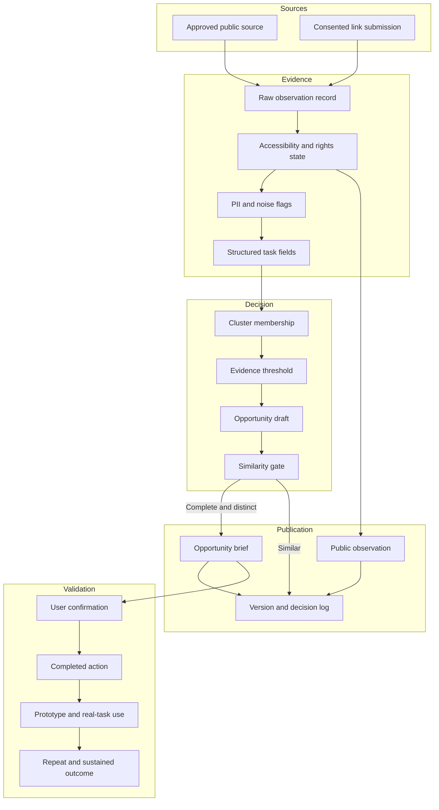

# Architecture

NeedRadar separates acquisition, evidence processing, decision policy, publication, and validation. The separation makes rights, uncertainty, and human ownership visible.

## Layer responsibilities

### Source governance

- stores the source policy separately from a fetched record;
- distinguishes active acquisition from submission-only intake;
- records access and removal state;
- does not interpret platform availability as permission.

### Evidence processing

- preserves the original source URL and minimal excerpt;
- flags likely noise and personal data;
- extracts task-oriented fields without overwriting the source record;
- logs reasons for classification and exclusion.

### Opportunity policy

- requires accessible, PII-safe observations;
- tests independent authorship or source-policy diversity;
- checks required decision fields;
- compares the candidate against published briefs;
- publishes, suppresses, or holds with explicit reasons.

### Public product

- defaults to English and persists a Chinese-language preference;
- supports opportunity and observation views;
- exposes provenance and validation boundaries;
- keeps account, correction, and builder actions separate from public reading.

### Validation

- treats higher levels as new evidence, not editorial upgrades;
- keeps withdrawal and audit history;
- exposes aggregate results without disclosing user identity;
- does not infer adoption from a prototype or public-interest count.

## Public portfolio boundary

This repository contains representative policy code, tests, diagrams, and the case presentation. Deployment credentials, the operational database, personal data, and private administrative interfaces are excluded.

