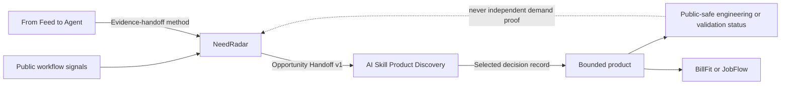

# Evidence-to-Execution Ecosystem

NeedRadar is the portfolio front door, not a monorepo and not a shared runtime. It moves a governed decision object between independent projects while each project keeps its own data, release, and safety boundary.

## Relationship vocabulary

| Relationship | Meaning | What it does not claim |
|---|---|---|
| `SYSTEM_OF_RECORD` | NeedRadar owns the governed opportunity brief and source references | That the opportunity is commercially validated |
| `VALIDATION_METHOD` | A research method can evaluate an exported opportunity | That a handoff has already been selected or approved |
| `REFERENCE_IMPLEMENTATION` | A product demonstrates a bounded implementation pattern | That it implements any current NeedRadar card |
| `METHOD_INPUT` | A study contributes provenance, verification, or consent patterns | That every row becomes an independent demand observation |
| `APPLIES_PATTERN` | A product applies similar evidence, approval, or safety controls | That it shares runtime code or private data with NeedRadar |

## Available now

- `GET /api/v1/projects` exposes the public project registry.
- `GET /api/v1/opportunities/{slug}/handoff` exports Opportunity Handoff v1.
- Every handoff keeps source references, counterevidence, unknowns, human gates, and the current validation level.
- The handoff links to the AI Skill Product Discovery case form, but never creates or submits an issue.

## Runtime and data boundary

The linked repositories do not import NeedRadar at runtime. A NeedRadar outage cannot stop BillFit, JobFlow, From Feed to Agent, or the discovery framework. Project metadata may be read by people or tools, but no downstream repository is automatically treated as demand evidence.

Private profiles, resumes, application state, account values, customer records, secure references, and proprietary material are outside the public contract.

## Non-circular validation

Repository existence, stars, forks, releases, tests, and builder plans are engineering or distribution signals. They cannot independently promote a NeedRadar opportunity. Product issues may later enter a separately labeled first-party feedback layer, but they must not be mixed into general public-demand counts.

Attach a product to a specific opportunity only after a person confirms semantic fit and the relation is recorded explicitly.
